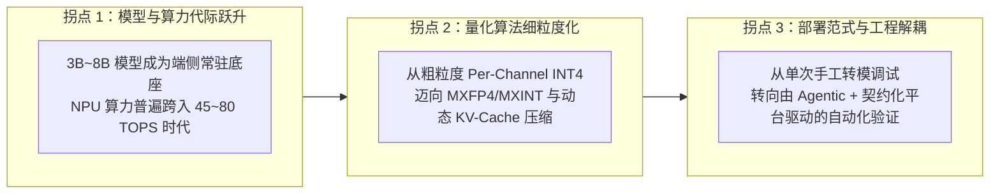
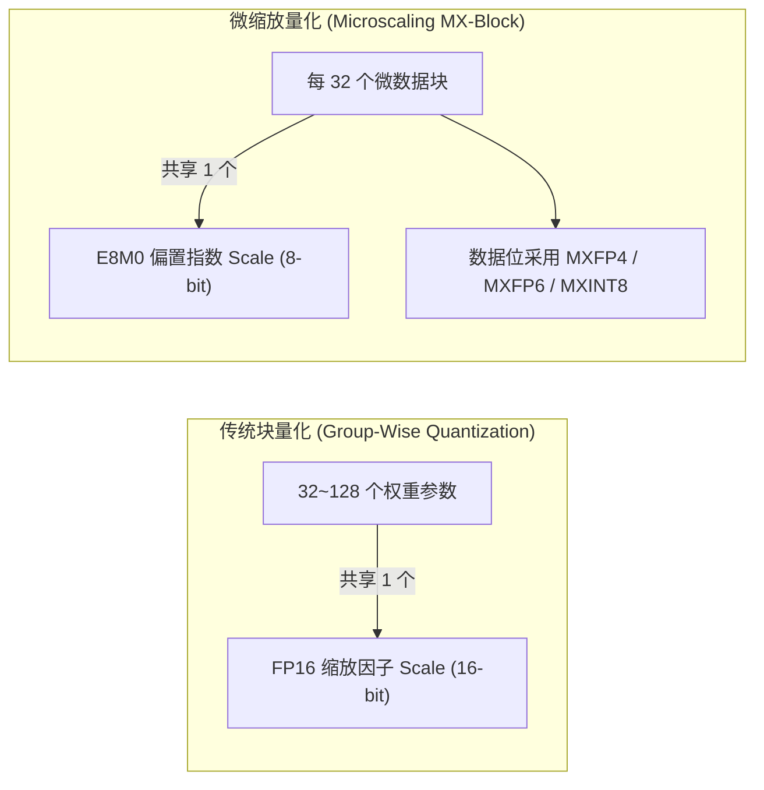
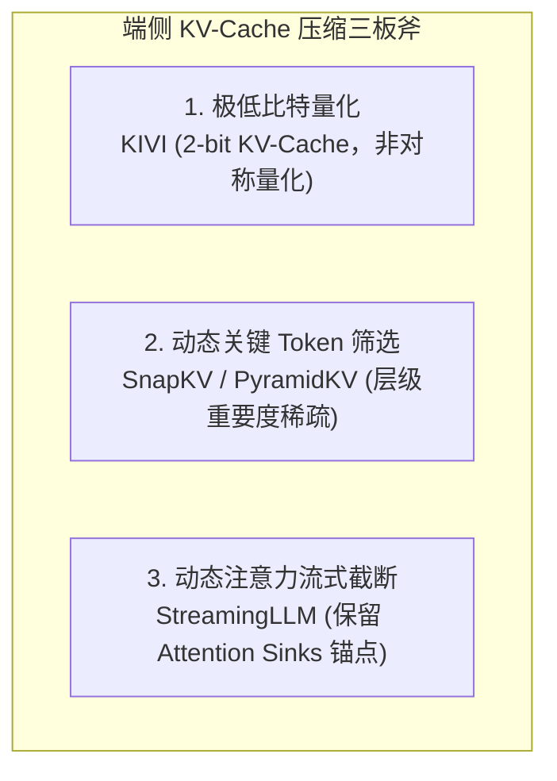
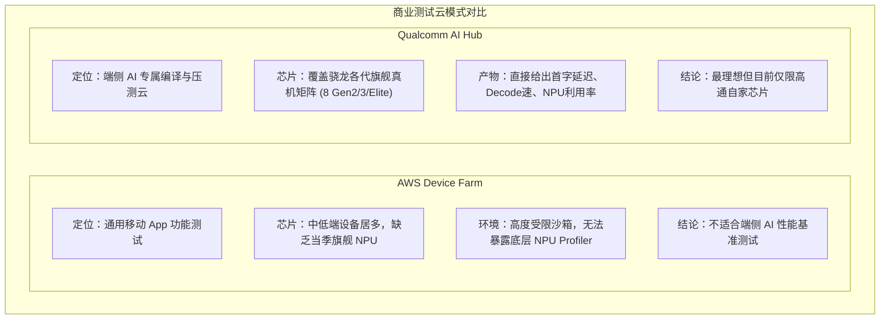
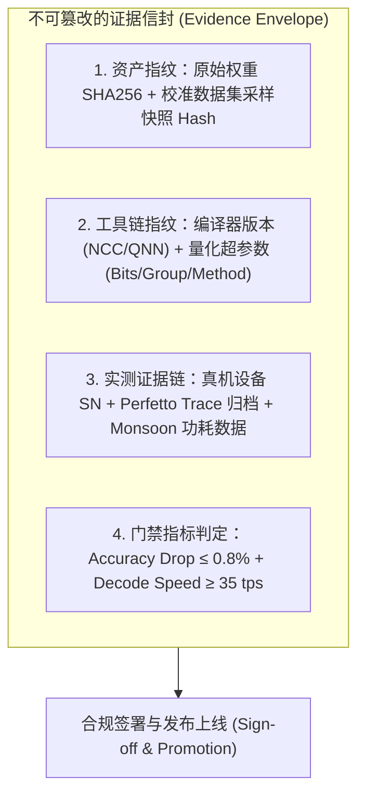

# 端侧 AI 与 Agentic 模型优化技术调研报告（2026 版）

**文档状态**：已完成 (Completed)  
**调研日期**：2026-10-24  
**目标定位**：系统性更新端侧 AI 芯片与厂商 SDK、大模型轻量化/量化算法、端侧统一部署运行时、真机自动化测试农场以及 Agentic 控制面协议的最新技术进展，为 Model Optimization MCP 的架构演进与落地提供一手技术决策输入。

---

## 目录

1. [执行摘要与技术趋势概览](#1-执行摘要与技术趋势概览)
2. [端侧 AI 芯片与厂商 SDK 最新代际调研](#2-端侧-ai-芯片与厂商-sdk-最新代际调研)
   - 2.1 Qualcomm: Snapdragon 8 Elite / X Elite 与 QNN SDK
   - 2.2 MediaTek: Dimensity 9400 与 NeuroPilot 8.x
   - 2.3 Apple: A18 Pro / M4 与 CoreML 8 / MLX
   - 2.4 Google: Tensor G4 与 LiteRT (TFLite 2.0)
   - 2.5 PC / NPU 终端: Intel Core Ultra (Lunar Lake) 与 AMD Strix Point
   - 2.6 主流芯片与 SDK 横向对比矩阵
3. [大模型端侧轻量化与量化算法前沿](#3-大模型端侧轻量化与量化算法前沿)
   - 3.1 细粒度微缩放格式 (Microscaling Formats: MXFP4 / MXFP6 / MXINT)
   - 3.2 极限低比特量化 (2~4 bit) 与异常值旋转 (SpinQuant / QuIP#)
   - 3.3 KV-Cache 极限压缩与动态注意力机制 (KIVI / SnapKV / StreamingLLM)
   - 3.4 自适应混合精度敏感度搜索 (Auto-Mixed Precision)
   - 3.5 端侧动态 LoRA 热插拔 (Dynamic LoRA Offloading)
4. [端侧统一部署运行时横向评测](#4-端侧统一部署运行时横向评测)
   - 4.1 Meta ExecuTorch: PyTorch 直通端侧的新标准
   - 4.2 Google LiteRT: 面向生成式 AI 的轻量化重构
   - 4.3 Microsoft ONNX Runtime Mobile: 跨平台成熟中间层
   - 4.4 开源轻量运行时: llama.cpp / MLC-LLM
   - 4.5 运行时选型决策全景矩阵
5. [端侧 AI 自动化评测实验室与设备云调研](#5-端侧-ai-自动化评测实验室与设备云调研)
   - 5.1 商业设备云对比：AWS Device Farm vs Qualcomm AI Hub
   - 5.2 自建 AI 真机评测实验室的核心工程要素
   - 5.3 温控与防降频门禁 (Thermal Cooling & Gating)
   - 5.4 动态功耗采样与性能分析追踪 (Perfetto / Vendor Tracers)
6. [Agentic 治理与平台控制面技术演进](#6-agentic-治理与平台控制面技术演进)
   - 6.1 Model Context Protocol (MCP) 最新协议演进与工程边界
   - 6.2 长周期长任务的耐久状态机 (Durable Execution)
   - 6.3 证据资产化与发布门禁 (Evidence Envelope & Fingerprinting)
7. [对 Model Optimization MCP 的架构落地启发](#7-对-model-optimization-mcp-的架构落地启发)

---

## 1. 执行摘要与技术趋势概览

从 2025 年末至 2026 年，端侧生成式 AI（On-Device GenAI）的落地形态发生了根本性转折，主要呈现出三大技术拐点：

1. **底座模型与硬件代际成熟**：3B~4B 级别模型（如 Qwen2.5/Qwen3-3B/4B、Llama 3.2 3B、Gemma 2 2.6B）已成为旗舰手机与 PC 端的常驻基础模型；高通 Snapdragon 8 Elite、联发科 Dimensity 9400、苹果 A18 Pro/M4 以及 Intel Lunar Lake 使得端侧专用 NPU 算力普遍达到 45~80 TOPS，端侧首字延迟（TTFT）进入百毫秒级，生成速率（Decode Speed）跨过 30~50 tokens/s 的实用门槛。
2. **轻量化重点转移：从“纯权重”到“KV-Cache + 混合精度”**：随着长文本（4K~32K）在端侧个人助理、文档摘要中普及，KV-Cache 显存占用已远超模型权重本身。基于 OCP 标准的 Microscaling 格式（MXFP4/MXFP6）以及 KIVI、SnapKV 等 KV 压缩方案成为新一代硬件和算法的标准支持项。
3. **平台工程化：从“手工转模脚本”走向“Agent 协同的证据流平台”**：碎片化的硬件生态（高通 HTP、联发科 APU、苹果 ANE、Intel NPU）使得单点优化极其脆弱。通过 MCP 协议解耦“本地智能体推理探索”与“中心化资产/调度/真机验证”，是企业应对多厂商适配的核心出路。

---

## 2. 端侧 AI 芯片与厂商 SDK 最新代际调研

### 2.1 Qualcomm: Snapdragon 8 Elite / X Elite 与 QNN SDK

高通在 2025/2026 年推出了全新 Oryon 自研架构的手机旗舰平台 **Snapdragon 8 Elite**（SM8750）与 PC 平台 **Snapdragon X Elite**，整体 AI 架构全面转向以自研 Hexagon NPU 为核心的异构计算：

- **硬件架构特性**：
  - **算力指标**：Hexagon NPU 综合算力最高达 80 TOPS（8 Elite）与 45 TOPS（X Elite），配备专属高带宽共享内存（Scalar/Vector/Tensor 单元共享 TCM 缓存），大幅降低外存 DRAM 搬运能耗。
  - **原生格式支持**：除了传统的 INT8/INT16 与 INT4 外，硬件原生支持 **FP8 (E4M3, E5M2)**，并在 Tensor 单元中集成了针对 Transformer Attention 的加速流水线。
- **Qualcomm AI Engine Direct (QNN SDK v2.2x+)**：
  - **工具链流向**：`PyTorch/ONNX` $\to$ `qnn-onnx-converter` / `qnn-pytorch-converter` $\to$ `qnn-model-lib-generator` $\to$ `qnn-context-binary-generator` (生成 `.bin` 序列化上下文)。
  - **HTP Backend 优化**：提供 `HTP V75/V79` 目标架构支持，提供 4 档性能模式（`burst`, `sustained_high_performance`, `balanced`, `power_saver`）。
  - **动态形状支持 (Dynamic Shapes)**：以往 QNN 强制要求静态形状（Static Shape），最新 QNN SDK 完善了 Graph Level 的有限动态维度支持（Bounded Dynamic Dimensions），降低了端侧变长 Prompt 的补齐开销。
- **Qualcomm AI Hub 的启示**：
  - 高通官方推出了 **Qualcomm AI Hub** 云服务，允许开发者上传 PyTorch/ONNX 模型，云端自动编译并派遣到真实的骁龙真机机架（包括 Galaxy S24/S25、Xiaomi 15 等旗舰）上执行性能压测，生成包含 **TTFT (Time-to-First-Token)**、**Decode Latency**、**Peak Memory**、**NPU Layer Coverage** 的结构化报告。
  - **对本平台的借鉴**：这是标准的“云端调度 + 真实芯片矩阵验证”工业实践，印证了我们将 `Device Farm` 作为一等公民的设计方向。

### 2.2 MediaTek: Dimensity 9400 与 NeuroPilot 8.x

联发科天玑 9400（Dimensity 9400）搭载全大核 CPU 架构与第 8 代 **APU 790**，在生成式 AI 上主打高能效与端侧微调融合：

- **硬件架构特性**：
  - **算力指标**：APU 790 具备 50+ TOPS 算力，官方实测端侧运行主流大语言模型可达 50 tokens/s 的解码速率。
  - **硬件级专有加速**：集成 Generative AI Engine，包含硬件级 **4-bit/8-bit KV-Cache 硬件无损/近无损解压单元**，并在硬件层面支持端侧 LoRA 权重动态融合加速。
- **NeuroPilot 8.x SDK**：
  - **双轨编译机制**：
    1. **在线推理 (Online Inference)**：通过 TFLite / ONNX Runtime + Neuron Delegate 运行，支持灵活的 CPU/GPU 算子平滑回退，适合开发探索阶段。
    2. **离线推理 (Offline Inference)**：使用 `ncc-tflite` / `ncc-onnx` 全量编译为硬件原生二进制 `.dla`，由 Neuron Runtime 直通 NPU 执行，性能与能效最高，但对算子支持度要求严苛。
  - **工具链升级**：`np-converter` 原生支持基于 PyTorch 2.x `torch.export` 与 FX 图捕获；提供专门针对 LLM 的分词器绑定与 C++ 端侧运行时封装。
  - **Neuron Studio 探针**：提供高精度的硬件性能分析，能够细分 DRAM 内存带宽占用率、MDLA（MediaTek Deep Learning Accelerator）利用率以及由于算子不支持触发的 CPU/GPU 上下文切换惩罚。

### 2.3 Apple: A18 Pro / M4 与 CoreML 8 / MLX

苹果在 A18 Pro（iPhone 16 Pro）与 M4 系列芯片中继续强化 Neural Engine（ANE）与统一内存架构（UMA）：

- **硬件架构特性**：
  - **算力与带宽**：16 核新一代 Neural Engine 达到 38 TOPS；苹果核心优势在于 **UMA 统一内存**，M4 内存带宽达到 120 GB/s（M4 Max 达 400+ GB/s），A18 Pro 达到近 60 GB/s。由于 LLM 解码阶段（Decode）本质是 Memory-Bound（内存带宽受限），苹果芯片在端侧跑 7B~14B 模型的大显存带宽吞吐表现处于行业领先。
- **CoreML 8 与 MIL 体系**：
  - **Stateful Models (状态化模型)**：针对 Transformer 自回归生成，CoreML 原生引入了持久化 KV-Cache 机制，无需每轮生成在 Python/Swift 层来回拷贝 KV 张量，直接由 ANE 硬件内部状态持久化，解码吞吐提升 2~3 倍。
  - **FP4 / INT4 细粒度量化**：支持 Block-wise (如 group-size=32/64/128) 权重量化与非对称量化。
- **MLX 开源框架生态**：
  - 苹果机器学习团队开源的 MLX 正在成为 macOS/iOS 上开发与优化大模型的首选工具。其具备与 PyTorch/NumPy 几乎一致的 API，但在底层直接绑定 Metal Performance Shaders (MPSGraph)，支持惰性求值（Lazy Evaluation）和统一内存零拷贝。

### 2.4 Google: Tensor G4 与 LiteRT (TFLite 2.0)

谷歌在 Pixel 9 系列搭载的 Tensor G4 上运行端侧 Gemini Nano，并对传统 TensorFlow Lite 进行了重大重构：

- **LiteRT (Lightweight Runtime)**：
  - 2024~2025 年，谷歌正式将移动端推理基础设施更名为 **LiteRT**，全面转向面向生成式 AI 优化的现代 C++ 架构。
  - 提供开箱即用的 **ODML (On-Device Machine Learning)** 算子库、LoRA 适配器动态加载器、以及对 Vulkan、OpenCL 和手机厂商 NPU 的标准 Delegate。
  - 对 Android 系统中自带的 AICore 服务（Android 15+）形成深度绑定，使第三方应用能复用系统常驻预热的端侧基础模型。

### 2.5 PC / NPU 终端: Intel Core Ultra (Lunar Lake) 与 AMD Strix Point

在 AI PC 领域，微软 Copilot+ PC 设立了 40+ TOPS NPU 的准入门槛：

- **Intel Lunar Lake (Core Ultra 200V 系列)**：
  - 搭载第四代 NPU，独立算力达到 48 TOPS，支持 OpenVINO 2025/2026 工具链，支持 NPU 上的直接 FP16/INT8/INT4 模型部署。
- **AMD Ryzen AI 300 系列 (Strix Point)**：
  - 搭载 XDNA 2 架构 NPU，算力达到 50 TOPS，业界首创支持 **Block FP16 (BFP16)** 精度，在兼具 16 位动态范围的同时仅占用 8 位数据的传输带宽。

### 2.6 主流芯片与 SDK 横向对比矩阵

| 厂商 / 平台 | 旗舰 SoC 代表 | NPU 架构与宣称算力 | 推荐工具链 / 编译器 | 主流量化精度支持 | 离线编译产物格式 | 核心痛点与限制 |
| :--- | :--- | :--- | :--- | :--- | :--- | :--- |
| **Qualcomm** | Snapdragon 8 Elite / X Elite | Hexagon (45~80 TOPS) | QNN SDK v2.2x+ | FP8, INT4, INT8, INT16 | `.bin` (QNN Context) | 驱动版本依赖严重；动态维度开销大；需要专用签名 |
| **MediaTek** | Dimensity 9400 / 9300+ | APU 790/780 (50+ TOPS) | NeuroPilot 8.x (`ncc-tflite`) | INT4, INT8, 混合精度 | `.dla` (Neuron DLA) | 离线编译对未受支持算子容忍度为零；NDA 文档壁垒较厚 |
| **Apple** | A18 Pro / M4 | Neural Engine (38 TOPS) | CoreML 8 / MLX | FP16, INT4, INT8, Stateful | `.mlmodelc` (Compiled) | 仅限苹果生态；无法手动精细控制 ANE 调度管线 |
| **Google** | Tensor G4 | Custom TPU (Pixel) | LiteRT (原 TFLite) | INT4, INT8, FP16 | `.tflite` / LiteRT FlatBuffer | 平台独占性高；开放 NPU 编译工具链相对有限 |
| **Intel** | Core Ultra 200V (Lunar Lake) | NPU 4.0 (48 TOPS) | OpenVINO 2025.x | FP16, INT8, INT4 | `.xml` + `.bin` (OpenVINO IR) | PC 专用；电源管理模式下功耗调节灵敏 |

---

## 3. 大模型端侧轻量化与量化算法前沿

传统服务端量化主要关注 INT8/INT4 权重压缩（W4A16），但端侧存在严苛的内存墙（Memory Wall）与能效比限制，前沿量化技术已呈现出全新的发展形态：

### 3.1 细粒度微缩放格式 (Microscaling Formats: MXFP4 / MXFP6 / MXINT)

由 OCP（Open Compute Project）牵头、各大主流芯片厂商联合支持的 **Microscaling (MX) Specification** 已成为下一代端侧 NPU 硬件量化的事实标准：

- **核心优势**：传统浮点在极低比特下表示范围受限，而 INT4 在激活值包含离群点（Outliers）时会引发严重的截断误差。MX 格式通过将缩放因子细化到极小的数据块（如 32 个元素），硬件直接处理缩放指数相加，不仅消除了浮点反量化的乘法开销，还在 4-bit 乃至 2-bit 下保留了接近原模型的困惑度（Perplexity）。
- **硬件支持**：ARMv9 架构最新向量扩展、Qualcomm 8 Elite、NVIDIA Blackwell 及新一代 APU 均已在微架构中规划对 MX 标准的指令加速。

### 3.2 极限低比特量化 (2~4 bit) 与异常值旋转 (SpinQuant / QuIP#)

当参数量化压缩至 4-bit 以下（如 3-bit / 2-bit）时，传统的 GPTQ/AWQ 精度急剧下滑。2025~2026 年突破性方案的核心思想是**“基底旋转消解异常值”**：

- **SpinQuant**：利用随机正交矩阵（Random Orthogonal Rotation Matrices）对权重矩阵和激活张量进行数学等价变换。由于旋转不改变特征内积，原本集中在少数通道（Channels）中的极端异常值被均匀发散到整个空间，从而让激进的 4-bit / 3-bit 均匀量化几乎不损失精度。
- **QuIP# 与 AQLM**：利用向量量化（Vector Quantization）与格子码本（Lattice Codebook），在端侧极限显存受限场景下（如手机端强行塞入 7B 模型至 3GB 显存以内），能够实现 2.5-bit 极低损耗存储，但需要端侧针对码本查找进行专用汇编优化。

### 3.3 KV-Cache 极限压缩与动态注意力机制 (KIVI / SnapKV / StreamingLLM)

在端侧长上下文场景下，KV-Cache 是显存爆炸的第一推手（例如 3B 模型在 8K 上下文、FP16 格式下，KV-Cache 显存需求超过 2GB，与模型本体体量相当）：

- **KIVI (2-bit KV Cache)**：针对 Key 矩阵的 Per-Channel 量化与针对 Value 矩阵的 Per-Token 量化，成功将 KV-Cache 压缩至 2-bit，显存占用直降 75%，并在 8K~16K 上下文内保持评测基准几乎零退化。
- **SnapKV / PyramidKV**：端侧推理观察到注意力权重高度聚焦在 Prompt 中的特定关键锚点。通过在 Prefill 阶段构建注意力特征指纹，在 Decode 阶段动态剔除 70% 的非关键 KV 块，使长文档问答在低配端侧设备上得以流畅运行。

### 3.4 自适应混合精度敏感度搜索 (Auto-Mixed Precision)

在端侧直接推行全局 INT4 往往会导致模型在特定任务（如逻辑推理、数学计算、代码生成）上发生“断崖式退化”。目前的最佳工业实践是**自适应混合精度敏感度搜索**：

1. **敏感度探测**：通过向网络输入微量校准样本，基于损失函数相对于每层权重的一阶梯度方差或 Hessian 矩阵迹（Trace of Hessian）评估各层的精度敏感指数。
2. **敏感层定位规律**：绝大多数 Transformer 结构中，首层 Embedding 映射、末层 Output Projection 以及各 Attention 模块中的 `Down-Proj` / `O-Proj` 对量化截断最为敏感，而中间 80% 的 MLP 升维层对量化容忍度极高。
3. **混合配比生成**：将 Top 5%~10% 的敏感权重保留为 FP16 或 INT8，其余 90% 激进压缩为 INT4 / INT3，以不到 5% 的显存与速度代价，挽回 90% 以上的精度损失。

### 3.5 端侧动态 LoRA 热插拔 (Dynamic LoRA Offloading)

端侧部署往往面临“单机多任务”需求（如同时需要：语音助手段落修饰、系统级私人邮件摘要、相机拍照风格提示词增强）：

- 如果为每个垂直功能各部署一个微调模型，端侧存储与内存完全无法承受。
- **最佳解法**：端侧基座模型经过量化编译后（如天玑 DLA 或高通 HTP 上下文），全量常驻且只读冻结。针对不同任务，动态从 Flash 存储拉取仅 10MB~50MB 的 LoRA 适配器权重（Adapter）。
- **工程挑战**：NPU 编译器通常不擅长在图执行中动态合并不同权重的张量。最新工具链方案（如 ExecuTorch LoRA Delegate、NeuroPilot LoRA Fusion）通过预留动态 LoRA 旁路算子通道，实现了毫秒级的无感任务切换。

---

## 4. 端侧统一部署运行时横向评测

由于各芯片厂商编译器彼此独立且私有，直接基于底层 C API 开发应用极其痛苦。因此，具备跨平台硬件抽象的端侧统一部署运行时成为了核心战场：

### 4.1 Meta ExecuTorch: PyTorch 直通端侧的新标准

**ExecuTorch** 是 Meta 联合 Arm、Apple、高通等厂商推出的面向边缘设备（手机、嵌入式、可穿戴设备）的官方轻量级运行时：

- **核心架构优势**：
  - **原生直通**：完全基于 PyTorch 2.x 的 `torch.export` 与 AOTInductor，摆脱了以往必须经过 ONNX 作为中介带来的算子表达丢失问题。
  - **模块化委托机制 (Backend Delegates)**：拥有成熟的 `QNN Delegate`（高通 Hexagon）、`MPS Delegate`（苹果 Metal）、`XNNPACK`（跨平台高性能 CPU）与 `Vulkan` 后端。
  - **微型内核**：C++ 核心运行时无需 Python 依赖，基础静态库占用小于数百 KB，内存分配完全支持离线预先规划（Zero dynamic allocation），防止端侧 OOM。

### 4.2 Google LiteRT: 面向生成式 AI 的轻量化重构

LiteRT（原 TFLite）在 2025 年完成了向生成式 AI 的深度演进：
- **专有 GenAI C++ 库**：内置了针对主流开源架构（Llama, Gemma, Qwen, Phi）的端到端管线，打包了分词器、KV-Cache 管理与采样逻辑。
- **生态穿透力**：在 Android 系统中拥有无可比拟的底层优势，与 Google Play 服务与系统级驱动紧密结合。

### 4.3 Microsoft ONNX Runtime Mobile: 跨平台成熟中间层

- **成熟度与兼容性**：支持最广泛的芯片与平台后端（QNN EP、CoreML EP、DirectML、Vitis AI）。
- **局限**：在端侧生成式大模型（LLM）的迭代速度上，略慢于专注于端侧大模型的原生框架；二进制包体积相较于 ExecuTorch 偏大。

### 4.4 开源轻量运行时: llama.cpp / MLC-LLM

- **llama.cpp**：几乎定义了 CPU 与 Apple Silicon 上的推理吞吐基准，其 GGUF 文件格式已经成为事实上的开源权重格式标准；但在手机端专用 NPU（高通 HTP / 联发科 APU）的原生硬件加速利用上，难以获得厂商驱动的第一方支持。
- **MLC-LLM (TVM Unity)**：基于编译优化的跨平台解决方案，主打利用 Vulkan / Metal / WebGPU 实现全平台端侧加速。

### 4.5 运行时选型决策全景矩阵

| 评估维度 | Meta ExecuTorch | Google LiteRT | ONNX Runtime Mobile | llama.cpp (GGUF) |
| :--- | :--- | :--- | :--- | :--- |
| **首要开发语言** | C++ / PyTorch Python | C++ / Java / Python | C++ / C# / Python | C / C++ |
| **与 PyTorch 生态结合** | ★★★★★ (原生直通) | ★★☆☆☆ (需经转换) | ★★★★☆ (Torch-ONNX) | ★★★☆☆ (需经转权重) |
| **高通 NPU (QNN) 支持** | ★★★★★ (官方 Delegate) | ★★★☆☆ (经 NNAPI/第三方) | ★★★★☆ (官方 QNN EP) | ★★☆☆☆ (仅 CPU/OpenCL) |
| **苹果 ANE / MPS 支持** | ★★★★☆ (MPS Delegate) | ★★☆☆☆ (CoreML Delegate) | ★★★★☆ (CoreML EP) | ★★★★★ (深度优化 Metal) |
| **联发科 APU (Neuron)** | ★★★☆☆ (社区适配中) | ★★★★☆ (原生 Neuron 代理) | ★★★☆☆ (第三方提供) | ★☆☆☆☆ (仅 CPU fallback) |
| **运行时最小体积** | < 1 MB | ~ 2 MB | ~ 8 MB | < 2 MB |
| **推荐适用场景** | 跨平台移动端自研大模型交付 | Android 生态极简部署 | 既有跨平台中台系统集成 | 极客评测与 CPU/Mac 部署 |

---

## 5. 端侧 AI 自动化评测实验室与设备云调研

在服务端，模型量化效果只需关注困惑度与 GPU 显存；但在端侧，**“在离线真机上的吞吐、发热、耗电与算子回退”才是唯一检验真理的标尺**。

### 5.1 商业设备云对比：AWS Device Farm vs Qualcomm AI Hub

很多团队在早期试图直接复用公有云设备农场，但往往遇到严重挫折：

### 5.2 自建 AI 真机评测实验室的核心工程要素

针对 30~50 人的工程团队，**搭建包含 10~20 台主流机型的内部轻量私有真机架（Private Device Farm）是性价比最高的长期资产**。自建实验室必须解决三大核心痛点：

#### 1. 物理层挑战：温控与防降频门禁 (Thermal Gating)
- **痛点**：端侧大模型压测会持续将 NPU 和 CPU 拉满。手机在运行 2~3 分钟后，机身温度迅速超过 42°C，操作系统会触发严重的**热节流（Thermal Throttling）**，导致时钟频率腰斩，测试出的吞吐可能剧烈抖动 30%~50%，使算法实验完全失去可比性。
- **工程解法**：
  - 硬件配备半导体制冷背夹或静音风冷散热架；
  - **调度前置冷却门禁 (Cool-down Gate)**：在测试任务启动前，调度器通过 ADB 查询电池与核心温度（`dumpsys thermalservice` / `cat /sys/class/thermal/...`），强制要求温度降至 35°C 以下方可开始基准测试。

#### 2. 动态功耗采样与性能指标闭环
- **测试指标不仅是速度，更要关注功耗（Joule per Token）**：
  - 接入 **Monsoon High Voltage Power Monitor** 硬件采样仪，或基于 Android `batterystats` 进行毫秒级电流积分，测量端侧大模型生成每 1000 个 Token 所消耗的电量。

#### 3. 全链路 Trace 自动化追踪与根因分析
- 当真机评测吞吐未达标时，不能只回传一个总毫秒数，必须附带系统级性能追踪文件：
  - **Android Perfetto**：捕获包含 NPU Driver 调度上下文、CPU 核心调度亲和性与内存争抢的完整 `.perfetto-trace`。
  - **Vendor Profilers**：联发科 Neuron Studio 抓取 `.ns-trace`，高通抓取 QNN Profiling JSON，由控制面自动解析出“哪些算子发生了 CPU Fallback”。

---

## 6. Agentic 治理与平台控制面技术演进

### 6.1 Model Context Protocol (MCP) 最新协议演进与工程边界

MCP（Model Context Protocol）作为连接 LLM 与外部系统的事实标准协议，在工业级落地中需明确其适用范围：

- **MCP 的强项**：作为标准化接口，向本地智能体（Claude Code, Cursor, Codex）暴露高语义的状态查询、契约合成与工作流提交能力。
- **协议进阶规范落地**：
  - **Resources**：向智能体以 URI 形式暴露只读数据，如 `platform://profiles/dimensity-9400`，不占用工具调用的选择注意力。
  - **Prompts**：将专家提示词模版（如“联发科量化意图澄清模版”）固化为服务端资源，确保不同客户端行为一致。
  - **Sampling**：服务端向客户端反向请求 LLM 智能推理（如控制面在分析复杂 Trace 异常时反向请求调用客户端智能体进行诊断）。
- **工程边界铁律**：**MCP 绝不能成为执行高负载计算的单体脚本**。在控制面背后，必须由正规的工作流调度器与内网 Worker 承载计算。

### 6.2 长周期长任务的耐久状态机 (Durable Execution)

端侧模型的量化校准、全量编译与真机 KPI 压测往往耗时 **5 ~ 30 分钟**。
- **传统 MCP 的致命问题**：单次 RPC / HTTP 请求超过 60 秒会触发网关超时断开；智能体在长时间挂起中极易丢失上下文或误判为异常。
- **设计解法**：
  - 引入 **异步任务凭证（Job Lease & Async Run ID）**：智能体调用 `submit_recipe_execution` 立即返回 `run_id` 与预估耗时，后续通过 `get_workflow_status` 轮询或基于 SSE 事件流监听。
  - 即使智能体客户端异常退出或重启，重新连入后通过 `run_id` 依然能从控制面恢复状态，实现持久化工作流（Durable Execution）。

### 6.3 证据资产化与发布门禁 (Evidence Envelope & Fingerprinting)

在工业级发布标准下，“一个量化模型能否进入线上应用”必须依赖完整的证据信封（Evidence Envelope），包含防篡改的多重指纹：

---

## 7. 对 Model Optimization MCP 的架构落地启发

结合上述前沿调研，本平台的后续演进应当落地以下具体改进：

### 1. 扩充平台画像库（Platform Profile Registry）
在 [catalog.py](file:///e:/Code/Learn/model-optimization-mcp/src/model_optimization_mcp/services/catalog.py) 中，将当前仅覆盖旧款型号（Dimensity 9300, Snapdragon 8 Gen 3）的平台定义，更新扩充为包括 **Snapdragon 8 Elite (SM8750)**、**Dimensity 9400 (APU 790)** 以及 **Apple M4/A18 Pro** 的最新配置，并补齐 `HTP V79`、`FP8 (E4M3/E5M2)` 以及 `KV-Cache 硬件压缩` 等最新硬件特征。

### 2. 升级 Recipe Spec 规范：支持细粒度混合精度与 KV-Cache 策略
将当前的 Recipe Spec 从单一的 `weight_bits`、`group_size` 扩展为支持：
- `kv_cache_quant`: `{"enabled": true, "method": "kivi-2bit" | "fp8"}`
- `mixed_precision_policy`: `{"sensitive_layers_keep": "fp16", "search_method": "hessian_trace"}`
- `outlier_mitigation`: `{"method": "spinquant" | "smoothquant"}`

### 3. 设备矩阵调度引入“温控降频门禁”机制
在 [device_farm.py](file:///e:/Code/Learn/model-optimization-mcp/src/model_optimization_mcp/services/device_farm.py) 中，增加真机测试前的设备环境检查：
- 支持 `thermal_status_check`（设备温度过高时自动进入等待排队，而非强行启动导致测速失真）。
- 扩展 KPI 评测报告，将 **TTFT (首字延迟)**、**Decode 吞吐 (Tokens/s)**、**每 Token 功耗 (mJ/token)** 作为一等公民指标输出。

### 4. 彻底收敛 Agent-Facing MCP 工具面
坚决贯彻本次调研结论：底层编译工具（`qnn-context-binary-generator`、`ncc-tflite` 等）必须退居为内部 Worker 工具；暴露给本地智能体的工具集中精力在**平台能力发现、意图澄清、Recipe 契约签署、工作流状态追踪与可信证据查验**上，打造真正适配 30~50 人团队的高效端侧模型交付平台。
