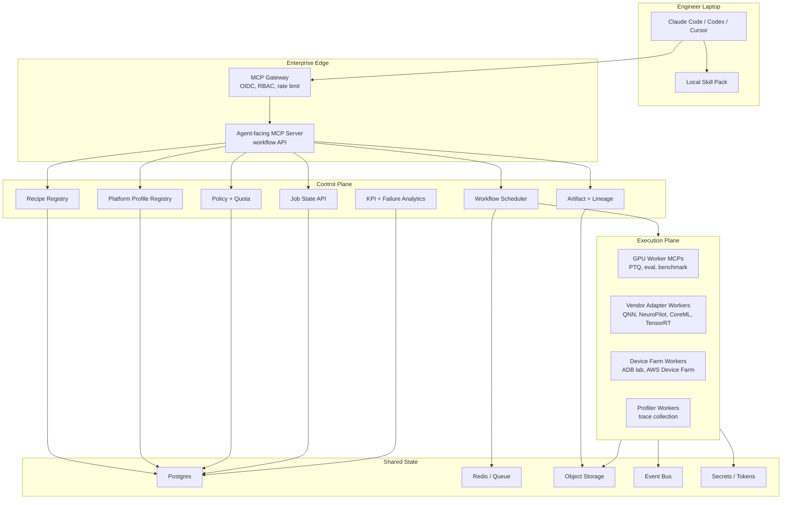

# Infrastructure Reference Architecture

Date: 2026-06-03
Status: Proposed

This document translates the current platform-aware design into a production infrastructure architecture. It assumes the repo now has these concepts:

- hybrid local skills plus MCP tools;
- platform profiles for MediaTek, Qualcomm, Apple, NVIDIA, and future vendors;
- vendor adapters for conversion, quantization, compilation, deployment, profiling, and failure analysis;
- device-farm KPI validation;
- recipe feedback and revision loops.

The key recommendation is: do not run this as one monolithic MCP server attached to a single GPU host. Treat MCP as the agent-facing protocol and build a real control plane behind it.

## 1. Target Shape



## 2. MCP Server Should Not Be One Server

Use three MCP surfaces.

### 2.1 Agent-Facing MCP Server

This is the only MCP endpoint exposed to engineer laptops.

Responsibilities:

- requirement intake;
- recipe synthesis, validation, approval;
- workflow plan creation;
- status inspection;
- report generation;
- safe artifact metadata access;
- high-level job submission.

It should not:

- expose arbitrary shell;
- expose raw vendor CLI arguments;
- let agents select physical GPU IDs;
- let agents access worker secrets;
- let agents mutate artifacts directly.

Suggested tools:

```text
start_quantization_intake
answer_intake_questions
synthesize_quantization_recipe
validate_quantization_recipe
approve_quantization_recipe
generate_hybrid_workflow_plan
select_compute_pool
create_execution_plan_from_recipe
submit_recipe_execution
get_workflow_status
get_artifact
generate_kpi_report
create_recipe_revision_from_feedback
```

### 2.2 Internal Worker MCP Servers

These are not exposed to local agents. They run inside the trusted network and are called by the control-plane scheduler.

Worker MCP categories:

- GPU worker MCP: PTQ, baseline eval, quantized eval, benchmark.
- Vendor adapter MCP: MediaTek NeuroPilot, Qualcomm QNN, Apple CoreML, NVIDIA TensorRT.
- Device farm MCP: ADB lab, AWS Device Farm, private phone farm.
- Profiler MCP: Neuron Studio, QNN profiling, Nsight, Perfetto, Xcode Instruments.

Worker tools can be lower-level because the caller is the scheduler, not a local agent.

Example internal worker tools:

```text
worker.prepare_workspace
worker.stage_inputs
worker.run_template
vendor.convert_model
vendor.quantize_model
vendor.compile_model
device.deploy_artifact
device.run_inference_matrix
profiler.collect_trace
profiler.summarize_trace
```

### 2.3 Admin MCP Server

Optional, but useful for platform operators.

Responsibilities:

- register compute nodes;
- register device lab devices;
- manage platform profiles;
- manage vendor adapter versions;
- inspect queues and quotas;
- pause pools;
- drain workers;
- review audit logs.

Do not expose admin tools to normal engineer agents.

## 3. Control Plane Services

The current code has service objects in-process. Production should split them conceptually, even if the first deployment runs in one process.

### 3.1 Recipe Service

Owns:

- `intake_sessions`;
- `recipe_specs`;
- `recipe_versions`;
- validation results;
- approvals;
- feedback and revisions.

Recipe is the central contract. Everything else should reference `recipe_id` and `recipe_version`.

### 3.2 Platform Registry Service

Owns:

- `platform_profiles`;
- `vendor_adapters`;
- SDK/toolchain versions;
- supported ops;
- known limitations;
- profiler support;
- packaging formats.

This service should answer:

- Can this model target this platform?
- Which adapter should run?
- Which questions are still missing?
- Which toolchain version is allowed?

### 3.3 Scheduler Service

Owns:

- workflow DAG;
- queue admission;
- lease allocation;
- worker dispatch;
- retries;
- cancellation;
- preemption;
- state transitions.

The scheduler should be the only component that calls internal worker MCPs.

### 3.4 Resource and Quota Service

Owns:

- GPU leases;
- device leases;
- project quotas;
- fair share;
- priority;
- reservation windows;
- TTL and heartbeat.

Local agents request resources. The service decides where work runs.

### 3.5 Artifact and Lineage Service

Owns:

- source models;
- calibration artifacts;
- converted models;
- quantized artifacts;
- compiled device artifacts;
- traces;
- KPI reports;
- final reports.

Artifacts live in object storage. Metadata lives in Postgres.

### 3.6 KPI and Failure Analytics Service

Owns:

- stage-aware failure classification;
- unsupported-op reports;
- CPU fallback reports;
- trace summaries;
- KPI pass/fail;
- root-cause hypotheses;
- recommended recipe feedback.

This service should consume both job events and profiler/device-farm results.

## 4. Infrastructure Components

### 4.1 Gateway

Use an MCP gateway or reverse proxy in front of the agent-facing MCP server.

Required:

- OIDC or SSO authentication;
- user and project identity propagation;
- per-tool authorization;
- rate limiting;
- audit request IDs;
- TLS or mTLS;
- allowlist of exposed tools.

### 4.2 Postgres

Use Postgres for durable control-plane state.

Tables should include:

```text
projects
users
models
datasets
recipes
recipe_versions
workflow_plans
jobs
job_events
leases
platform_profiles
vendor_adapters
device_pools
devices
artifacts
kpi_reports
failure_analyses
approvals
audit_events
```

Do not use JSON files beyond local demo mode.

### 4.3 Redis or Queue

Use Redis, RabbitMQ, Kafka, or a cloud queue for:

- job dispatch;
- worker heartbeats;
- status fanout;
- lease expiration;
- event buffering.

For early production, Redis Streams is enough. For larger deployment, Kafka is better for durable event history.

### 4.4 Object Storage

Use S3, MinIO, Ceph, or internal object storage for:

- model artifacts;
- converted files;
- quantized files;
- compiled binaries;
- logs;
- profiler traces;
- device screenshots or reports;
- generated Markdown/PDF reports.

All object writes should create an artifact metadata row.

### 4.5 Compute Execution

Support multiple backends behind one scheduler abstraction.

Recommended order:

1. Docker runner for one GPU server.
2. Kubernetes Jobs for team-scale GPU pools.
3. Slurm adapter if the org already has HPC scheduling.
4. Ray adapter for distributed eval/benchmark.

Workers should register:

```text
worker_id
pool_id
node_id
capabilities
runtime_envs
gpu_type
gpu_memory
heartbeat
current_jobs
```

### 4.6 Device Farm

Treat device farm as a first-class execution plane, not a benchmark script.

Possible backends:

- private Android ADB lab;
- AWS Device Farm;
- vendor dev boards;
- partner device lab.

A device controller should own:

- device reservation;
- flashing or environment reset;
- artifact installation;
- test execution;
- log pull;
- trace collection;
- cleanup.

### 4.7 Observability

Use:

- OpenTelemetry traces for workflow/job spans;
- Prometheus metrics for queue, jobs, leases, workers, devices;
- centralized logs for worker stdout/stderr;
- Grafana dashboards for pool health;
- alerting for stalled jobs, heartbeat loss, disk pressure, and device farm failure rate.

## 5. Recommended Deployment Topologies

### 5.1 MVP Team Deployment

```text
1 VM:
  agent-facing MCP
  Postgres
  Redis
  MinIO

N GPU servers:
  worker MCP
  Docker runner
  mounted cache

N phones/dev boards:
  device farm worker
  ADB controller
```

Good for one team.

### 5.2 Production Kubernetes Deployment

```text
Kubernetes:
  mcp-gateway
  public-mcp-server
  recipe-service
  scheduler-service
  artifact-service
  kpi-service
  worker-controller

External:
  Postgres
  Redis/Kafka
  S3/MinIO/Ceph
  Vault
  GPU node pools
  device farm
```

Good for many engineers and many GPU servers.

### 5.3 Federated Enterprise Deployment

```text
Central control plane:
  recipes
  platform profiles
  artifacts
  approvals
  global quota

Regional execution planes:
  GPU pools
  device farms
  local cache
  regional workers
```

Good when device labs and GPU pools are in different locations.

## 6. Workflow Execution Contract

Every workflow step should have:

```json
{
  "step_id": "platform-conversion-mediatek",
  "executor": "mcp_worker",
  "worker_type": "vendor-adapter",
  "required_capabilities": ["mediatek-neuropilot", "ncc-tflite"],
  "inputs": {
    "recipe_id": "qr-123",
    "artifact_id": "artifact-source"
  },
  "outputs": {
    "artifact_type": "converted_model"
  },
  "retry_policy": {
    "max_attempts": 2,
    "retry_on": ["worker_lost", "transient_io"]
  },
  "failure_handler": "analyze_conversion_failure"
}
```

This makes workflow plans executable by a scheduler, not just readable by an agent.

## 7. MCP Tool Design Adjustments

The current repo has platform data and skills, but the agent-facing MCP surface should be tightened.

### Add or Align These Agent-Facing Tools

```text
list_platform_profiles
get_platform_profile
get_platform_specific_questions
validate_recipe_platform_compatibility
list_vendor_adapters
get_vendor_adapter
submit_recipe_execution
get_workflow_status
get_step_status
get_trace_artifact
```

### Keep These Internal-Only

```text
convert_model_vendor
quantize_model_vendor
compile_model_vendor
deploy_to_device
run_device_inference
collect_device_profile
analyze_conversion_failure
analyze_compile_failure
analyze_runtime_failure
```

If exposed to agents, these should only accept `recipe_id` and `step_id`, never raw shell-like arguments.

## 8. Current Repo Gaps To Address

These are not criticisms; they are the next engineering cuts.

1. Some docs and tests contain mojibake text such as `鈫?` and `鐢?`. Fix encoding so GitHub and Chinese intent tests are trustworthy.
2. Skills reference tools such as `get_platform_profile`, `check_op_compatibility`, and `convert_model_vendor`, but the current MCP server surface does not yet expose all of them.
3. `platform_profiles` and `vendor_adapters` are catalog entries, but there is no dedicated `PlatformRegistryService` yet.
4. `JobManager` still runs in-process threads. Production needs queue-backed workers.
5. `ResourceManager` reads local `nvidia-smi`; production pool capacity should come from worker heartbeats and scheduler state.
6. `DeviceFarm` is still simulation-oriented; split private ADB lab, AWS Device Farm, and vendor dev-board adapters.
7. JSON store is fine for demo but should become Postgres plus object storage and event queue.
8. Failure analysis should be separate from generic job failure and should attach trace artifacts.

## 9. Suggested Implementation Roadmap

### Phase 1: Align Interfaces

- Add `PlatformRegistryService`.
- Add agent-facing platform profile tools.
- Add `WorkflowExecutionService`.
- Align skill names with actual MCP tools.
- Fix mojibake in docs, tests, and skills.

### Phase 2: Queue-Backed Execution

- Add Redis Streams or RabbitMQ.
- Change jobs from in-process threads to queued tasks.
- Add worker registration and heartbeat.
- Add internal worker MCP client abstraction.

### Phase 3: Artifact and State Hardening

- Add Postgres store.
- Add object storage artifact writer.
- Add event log table.
- Add lineage graph queries.

### Phase 4: Real Execution Adapters

- Docker GPU worker.
- Kubernetes GPU worker.
- MediaTek adapter worker.
- Qualcomm adapter worker.
- AWS Device Farm worker.
- ADB lab worker.

### Phase 5: Production Governance

- Add OIDC/RBAC.
- Add quota and budget policies.
- Add approval integration.
- Add audit retention.
- Add dashboards and alerts.

## 10. Recommended Mental Model

Local agents and skills should behave like product engineers operating a lab.

The MCP control plane should behave like the lab management system.

Workers should behave like lab equipment.

Recipes should behave like signed experiment contracts.

Artifacts, KPI reports, traces, and failure analyses should behave like evidence.

This separation will make the platform robust even when engineers use different local agents.

