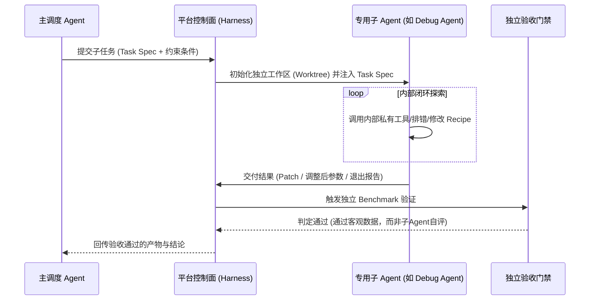

# 跨团队 Skill 与 Agent 整合架构指南 (Multi-Team Skill & Agent Integration Guide)

> **适用范围**：面向多团队、多技术栈（量化、编译器、推理引擎、Device Farm、算法等）并行的 AI 工程平台，指导如何标准化整合各专业团队输出的 Skill、Tool/MCP 与 Agent。

---

## 1. 为什么需要这份指南？

随着大模型落地与端侧模型接入（Model Onboarding）进入深水区，平台往往需要吸纳来自多个专业团队的研发资产：
* **量化团队**：维护 Python API、自研 PTQ/QAT 算法与精度回退排查脚本；
* **编译器/Runtime 团队**：维护 C++/CLI 工具、特定芯片（如 MTK NeuroPilot、高通 QNN）算子转换与编译链路；
* **测试与硬件团队**：维护 Device Farm 调度、手机机群、功耗/吞吐自动化测试；
* **业务/算法团队**：沉淀了特定模型结构适配的大量经验参数与避坑指南。

如果不加规范地整合，平台通常会迅速掉入**“网状混乱”**的泥潭：
1. **形态混乱**：有的团队提供 REST API，有的给 CLI 脚本，有的写了几页 Markdown（Skill），有的自己起了一个带复杂 Prompt 的独立 Agent；
2. **“全员 Agent 综合征”**：盲目为每个内部组件包装一个拟人化 Agent，导致多 Agent 自由对话时信息严重失真、延迟爆炸、成本失控；
3. **上下文雪崩（Context Explosion）**：把所有团队的工具、参数和文档全塞进主 Agent 的 Prompt，造成工具匹配幻觉与上下文超限；
4. **长任务脱节**：底层编译或真机压测耗时数十分钟，同步调用直接导致 Agent 会话超时断连；
5. **责任与验收边界不清**：子 Agent 声称“优化完成”，实际在真机上崩溃或精度严重劣化。

---

## 2. 核心架构哲学：形态降维与职责边界

平台整合的最高原则是：**“做连接层与调度底座，不重造基础设施；做能力降维，不搞全员 Agent”**。

```
┌────────────────────────────────────────────────────────┐
│                      通用主 Agent                      │
│            理解任务意图 · 编排执行计划 · 分析反馈      │
└───────────────────────────┬────────────────────────────┘
                            │
┌───────────────────────────▼────────────────────────────┐
│      平台能力底座 (Model Optimization MCP Control Plane) │
│  - 统一能力目录 (Capability Catalog)                   │
│  - 统一执行 Harness (Job Manager / Async Workers)      │
│  - 统一工作区与产物库 (Workspace & Artifacts)          │
│  - 统一独立验收门禁 (Independent Verifier)              │
└───────────────┬─────────────────────────┬──────────────┘
                │                         │
     ┌──────────┴──────────┐   ┌──────────┴──────────┐
     ▼                     ▼   ▼                     ▼
【Tier 1: 确定性工具】   【Tier 2: 经验导航】     【Tier 3: 自治子代理】
MCP Tools / APIs         Curated Skills          Specialist Subagents
(量化/编译/Device测试)   (参数策略/避坑SOP)      (NAS/超参搜索/深度Debug)
```

### 能力三层分类原则（Three-Tier Taxonomy）

| 层级 | 形态 | 核心特征 | 平台接入方式 | 典型示例 |
| :--- | :--- | :--- | :--- | :--- |
| **Tier 1: 工具层 (Tools / MCP)** | 标准 API / CLI / MCP Tool | **确定性执行、无多轮意图分歧、有明确输入输出与退出码**。是平台的基石。 | 封装为标准 MCP Tool 或异步 Job；提供清晰的 JSON Schema。 | 模型权重转换、Device Farm 真机测试、Profiler 采集、状态查询。 |
| **Tier 2: 经验层 (Curated Skills)** | Markdown 文档规范 (`SKILL.md`) | **非确定性的领域专家知识、起步导航、推荐参数套路、排错决策树**。 | 挂载于平台的 Skill 仓库；由主 Agent **按需读取**，不常驻 Prompt。 | MTK NPU 内存对齐规则、Qwen 激活值异常截断经验、常见精度回退应对方案。 |
| **Tier 3: 子代理层 (Subagents)** | 独立 Agent 实例 (带独立会话/沙箱) | **具备独立的决策探索空间，需要内部多轮试错和自主状态机，且调用专用工具链**。 | 采用 **Contract Handoff（契约交接）**，限定生命周期与资源预算。 | 神经架构搜索（NAS）Agent、复杂算子融合自动调优 Agent。 |

> **金律**：能用脚本/API 搞定的绝不做成 Agent；能通过静态文档指导主 Agent 调用的，绝不拆分独立子系统。

---

## 3. 关键机制设计

### 3.1 两级发现与上下文按需加载（Two-Tier Capability Discovery）

为了避免数十个团队的工具和文档撑爆上下文，平台在 `services/catalog.py` 中推行两级发现机制：

1. **L1 目录索引（Lightweight Metadata）**：
   * 启动时，主 Agent 仅感知精简的能力元数据清单（名称、领域标签、一行说明、Owner）。
   * 示例：
     ```json
     {
       "id": "mtk-neuropilot-quantizer",
       "category": "quantization",
       "supported_chips": ["dimensity-9300", "dimensity-9400"],
       "summary": "MTK NeuroPilot 官方 PTQ 8-bit/4-bit 量化工具链"
     }
     ```
2. **L2 详情按需装载（On-demand Hydration）**：
   * 仅当主 Agent 确认需要采用该方案时，调用 `get_capability_contract(id)`，平台才动态返回该组件的参数 Schema、环境前置依赖、典型用例（Examples）和关联的 Skill 经验。

---

### 3.2 统一 Execution Harness（长任务与生命周期管理）

跨团队工具最大的敌人是**阻塞与超时**。平台作为 Execution Harness，必须把持长任务控制权：

1. **异步化与 Job 追踪**：
   * 外团队接入的所有重型任务（编译、量化、端侧压测），必须接入平台的统一异步接口，返回结构化 `job_id`：
     ```json
     {
       "job_id": "job_quant_88a1b2",
       "status": "RUNNING",
       "poll_interval_sec": 30,
       "cancel_url": "/api/v1/jobs/job_quant_88a1b2/cancel"
     }
     ```
2. **环境与运行记录持久化**：
   * 平台记录完整的执行对象链条：`Task`（意图） -> `Run`（实例） -> `Environment`（芯片型号、驱动、容器镜像） -> `Artifacts`（量化结果模型、Benchmark 数据）。
   * 对话因断网、超时关闭后，Agent 随时可通过 `job_id` 恢复现场并获取结构化结果。

---

### 3.3 跨团队 Agent 协同：契约式交接（Contract-Driven Handoff）

若必须调用第三方团队开发的专属 Agent，杜绝自由文本乱聊，推行结构化**契约交接**：



* **独立验收（Independent Verification）原则**：子 Agent 的自评不能作为交付凭据，必须由平台独立的 Verifier 依据真实设备 KPI（精度、内存占用、延迟）进行裁决。

---

## 4. 平台接入规范清单（RFC Template）

要求各业务团队接入平台时，提供符合规范的描述文件 `capability-manifest.yaml`：

```yaml
schema_version: "v1.0"
capability_id: "vendor-xnn-quantization"
name: "XNNPTQ Quantization Suite"
maintainer:
  team: "Edge-AI-Compiler-Team"
  slack_channel: "#model-compiler-dev"

type: "mcp_tool" # mcp_tool | skill | specialized_agent

# 1. 适用性与支持矩阵 (Applicability Matrix)
applicability:
  frameworks: ["PyTorch>=2.2", "ONNX>=1.15"]
  hardware_targets: ["SoC-8Gen3", "SoC-9400"]
  precision_modes: ["INT4_AWQ", "INT8_SMOOTHQUANT", "FP8"]

# 2. 执行接口契约 (Execution Contract)
interface:
  protocol: "mcp" # mcp | cli_runner | async_http
  is_async: true
  timeout_seconds: 3600
  inputs:
    model_artifact_id: { type: "string", required: true }
    recipe_config: { type: "object", schema_path: "./schemas/recipe.json" }
  outputs:
    quantized_model_id: { type: "string" }
    quant_report_csv: { type: "string" }

# 3. 关联技能与经验导航 (Linked Skills)
associated_skills:
  - path: "./skills/xnn-badcase-tuning.md"
    description: "XNN 编译器量化精度严重回退时的手动插层调优手册"

# 4. 健康检查与准入测试 (Health Check)
validation:
  smoke_test_cmd: "pytest tests/smoke_test.py"
```

---

## 5. 落地推进步骤（Roadmap）

1. **第一阶段：制定契约与统一 Catalog（当前阶段）**
   * 在现有 `catalog.py` 与 `schemas.py` 中固化 Capability Manifest 数据结构；
   * 收集各团队的核心工具，统一封装为标准 Tool/MCP，先不急于开发新 Agent。
2. **第二阶段：打通统一 Harness 与异步 Job 状态机**
   * 依托 `job_manager.py` 和 `device_farm.py`，把各团队耗时的运行统一转化为带 `job_id` 的异步任务；
   * 统一收集各团队工具产生的日志与产物，集中存储至 `artifacts.py`。
3. **第三阶段：沉淀高质量 Curated Skills**
   * 联合各团队算法工程师，把容易出错的隐性参数（如对齐字节、校准数据集挑选策略）整理为标准的 Skill 目录；
   * 主 Agent 遇到对应错误码时，自动关联拉取对应 Skill 引导排错。
4. **第四阶段：引入受控的 Specialist Subagents**
   * 仅在神经架构搜索、特定算子级自动优化等深度场景下，接入遵循契约交接的外部专用 Agent。
